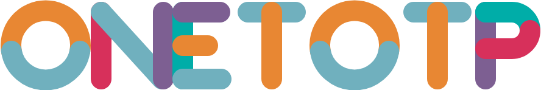

# ONETOTP 字标 · SVG（几何重建版）

上一版是用**自动描摹**做的（沿像素边缘走线），结果有锯齿、有"手涂感"——那是把位图换了个壳，不是矢量设计稿。

这一版换掉方法：**按几何重画**。这个字标本质上是用**等粗圆头笔画**画出来的，每一笔不是直线就是圆弧。把它们还原成数学上的线段和圆弧，就得到真正的矢量。

文件：`oneTotp-ONETOTP.svg`（888 × 148，**2.5 KB**，18 条描边路径）



---

## 1. 为什么自动描摹一定会难看

自动描摹是"沿着抗锯齿像素的 50% 边界走一圈"，所以：

- 直线的边缘**不是直线**，而是振幅 1px 左右、周期几像素的锯齿带；
- 圆弧的曲率**不均匀**，肉眼就是"手涂感"；
- 平滑算法（滑动平均 / 中点二次曲线）只能把锯齿磨圆，代价是轮廓整体变胖变糊，且每修改一次都会引入新的抖动。

而这类 logo 的真相是：**笔画宽度恒定 34px，所有笔画都是直线段或标准圆弧**。只要识别出这一点，就能一步得到零误差的几何。

---

## 2. 怎么测出来的

| 步骤 | 做法 |
| --- | --- |
| **1. 分色** | 按饱和度分离墨迹与背景（顺带剔除水印），再按邻域色差切出各个色块 |
| **2. 骨架化** | 对每个色块做 Zhang-Suen 细化，得到笔画的中心线 |
| **3. 距离变换** | 两遍 chamfer 距离变换，骨架处的距离值 × 2 = **该笔画的真实宽度** |
| **4. 递归拟合** | 对每段骨架同时做直线拟合与圆拟合，误差超阈值就在误差最大处切开递归——**能自动识别出拐点**，一条路径要么是直线要么是圆弧 |
| **5. 校验** | 把结果与原图做逐像素误差度量，反复校准 |

拟合出来的平均误差多在 **0.1 ~ 1.5 px**，这直接证明了"这些笔画确实是直线和圆弧"。

实测得到的关键参数：

| 项目 | 实测值 |
| --- | --- |
| 笔画宽度 | **34 px**（圆头端帽） |
| 大写上下中心线 | y = 24 / y = 134 |
| O 的中心线半径 | 57 px（有 overshoot：外径 148 > 大写字高 144） |
| O 的橙/蓝分界 | y = 88（略低于圆心 78.5） |
| 中横中心线 | y = 79 |
| P 的碗 | 半径 30，右缘中心线 x = 874 |

---

## 3. 最终 SVG 的全部内容

整份文件 18 条路径，每一条都是一个 `M` 加一个 `L` 或 `A`——没有一条多余的控制点：

```
<path d="M 22.80 88 A 57 57 0 1 1 135.20 88"  stroke="#E88733"  stroke-width="34" .../>   橙 · O 上半弧
<path d="M 135.20 88 A 57 57 0 0 1 22.80 88"  stroke="#70B0BE"  stroke-width="34" .../>   蓝灰 · O 下半弧
<path d="M 170 24 L 170 134"                  stroke="#D7305B"  stroke-width="34" .../>   玫红 · N 左竖
<path d="M 170 24 L 270 134"                  stroke="#70B0BE"  stroke-width="34" .../>   蓝灰 · N 斜笔
<path d="M 272 24 L 272 134"                  stroke="#7D5F92"  stroke-width="34" .../>   紫 · N 右竖
<path d="M 304 24 L 304 134"                  stroke="#00ADA8"  stroke-width="34" .../>   青绿 · E 竖
<path d="M 304 24 L 365 24"                   stroke="#7D5F92"  stroke-width="34" .../>   紫 · E 上横
<path d="M 304 79 L 345 79"                   stroke="#E88733"  stroke-width="34" .../>   橙 · E 中横
<path d="M 304 134 L 367 134"                 stroke="#70B0BE"  stroke-width="34" .../>   蓝灰 · E 下横
<path d="M 411 24 L 489 24"                   stroke="#70B0BE"  stroke-width="34" .../>   蓝灰 · T₁ 横
<path d="M 450 24 L 450 134"                  stroke="#E88733"  stroke-width="34" .../>   橙 · T₁ 竖
<path d="M 529.80 88 A 57 57 0 1 1 642.20 88" stroke="#E88733"  stroke-width="34" .../>   橙 · O₂ 上半弧
<path d="M 642.20 88 A 57 57 0 0 1 529.80 88" stroke="#70B0BE"  stroke-width="34" .../>   蓝灰 · O₂ 下半弧
<path d="M 683 24 L 761 24"                   stroke="#70B0BE"  stroke-width="34" .../>   蓝灰 · T₂ 横
<path d="M 722 24 L 722 134"                  stroke="#E88733"  stroke-width="34" .../>   橙 · T₂ 竖
<path d="M 801 24 L 801 134"                  stroke="#7D5F92"  stroke-width="34" .../>   紫 · P 竖
<path d="M 801 24 L 844 24 A 30 30 0 0 1 874 54"    stroke="#00ADA8" .../>                青绿 · P 上横 + 右上弧
<path d="M 874 54 A 30 30 0 0 1 844 84 L 801 84"    stroke="#D7305B" .../>                玫红 · P 右下弧 + 中横
```

**2.5 KB**，对比自动描摹版的 **14.8 KB**——小 6 倍，而且每一笔都可读、可调。

---

## 4. 配色

| 色值 | 位置 |
| --- | --- |
| `#E88733` | 橙 —— 两个 `O` 的上半弧、`E` 中横、两个 `T` 的竖 |
| `#70B0BE` | 蓝灰 —— 两个 `O` 的下半弧、`N` 斜笔、`T` 横、`E` 下横 |
| `#D7305B` | 玫红 —— `N` 左竖、`P` 的碗 |
| `#7D5F92` | 紫 —— `N` 右竖、`E` 上下横的左段、`P` 竖 |
| `#00ADA8` | 青绿 —— `E` 的竖、`P` 的右上弧 |

改色只需替换对应 `<path>` 的 `stroke`；改笔画粗细只需改 `stroke-width`（全部 34）。

---

## 5. 关于水印

原图带「LOGO…」斜向灰色水印（取样值 `#EFF0F0`，饱和度仅 **1**），字标全部是高饱和彩色。
按**饱和度 ≥ 30** 判定墨迹，水印在第一就被整体排除，矢量结果不含任何水印像素。

---

## 6. 说明

- 文件：`oneTotp-ONETOTP.svg`（888 × 148）
- `preview.html` 里有原图对照、缩放表现、深色底、配色
- 未改动任何源码：`develop/` 下的源文件、`tauri.conf.json`、`src-tauri/icons/` 均保持原样
- **未完成**：小写 `oneTotp` 那套（`Design/logo/`）仍是用自动描摹做的，需要同样重做——它的字形也是等粗笔画（宽 14.5px），可以同样还原成线段与圆弧；但其中的图形标记是有机形状（多块椭圆叠色），需要单独按其设计结构（旋转椭圆）重建
